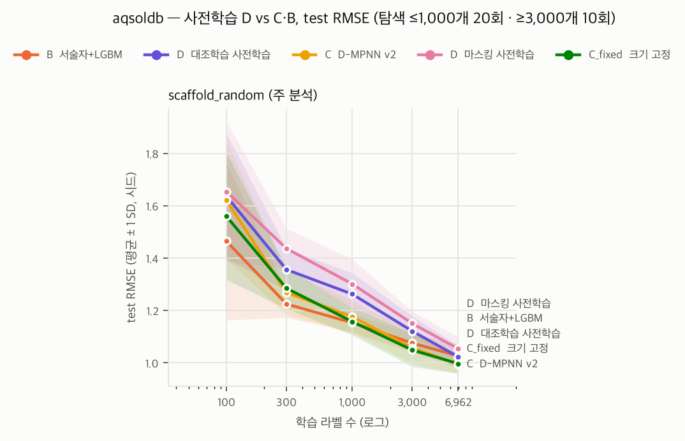
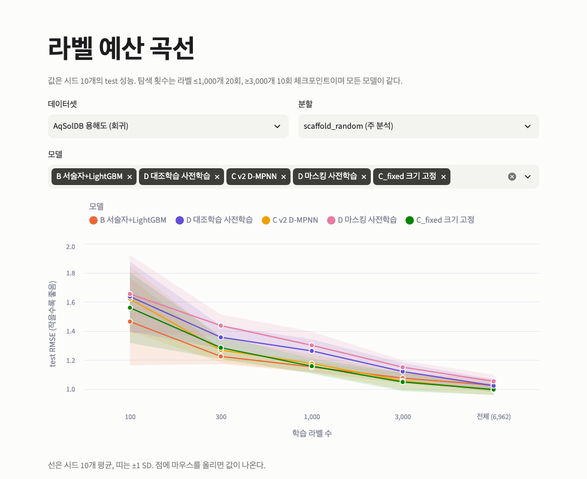
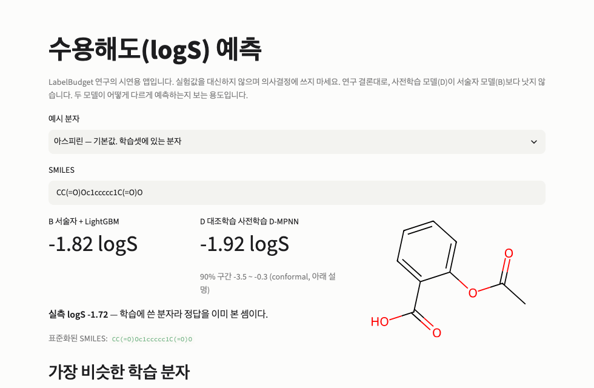

# LabelBudget

> 분자 물성 예측에서 자기지도 사전학습의 이득은 라벨 몇 개까지 유효한가?

**🔗 웹 앱 [labelbudget.streamlit.app](https://labelbudget.streamlit.app)** · **저장소 [github.com/LabelBudget/LabelBudget-Main](https://github.com/LabelBudget/LabelBudget-Main)** · **한계 [LIMITATIONS.md](LIMITATIONS.md)**

**결론: 이 설정에서는 라벨이 몇 개이든 유효하지 않았다.**
서술자 + LightGBM(B)이 라벨 100개부터 전체까지 가장 강하거나 같았다. ZINC250k로 사전학습한 D-MPNN(D)은 용해도(AqSolDB)에서 같은 크기의 사전학습 없는 모델보다 오히려 나빴고(부정적 전이), 독성(Tox21 SR-ARE)에서는 효과가 없었다.
판정 규칙은 결과를 보기 전에 커밋했고([`05_PRETRAIN_SPEC.md`](docs/design/05_PRETRAIN_SPEC.md) §4, 커밋 `3f50a0f`), 부정적 결과를 그대로 보고한다.



## 1. 해결하려 한 문제

신약·소재 개발에서 분자 물성 라벨은 실험으로만 얻을 수 있어 비싸다. 그래서 라벨 없는 분자 수십만 개로 GNN을 먼저 학습하는 **자기지도 사전학습**이 대안으로 제안됐다. 그런데 문헌의 답이 엇갈린다. 사전학습이 도움이 된다는 보고와, 공정하게 비교하면 이득이 거의 없고 서술자 기반 고전 ML이 여전히 강하다는 보고(Sun et al. 2022, Nature Communications 2023)가 함께 있다.

이 프로젝트는 질문을 "도움이 되는가"에서 **라벨이 몇 개일 때까지 도움이 되는가**로 바꿨다. 라벨 100개부터 전체까지 예산을 늘려 가며, 같은 분할·같은 탐색 예산·같은 시드로 서술자 모델과 사전학습 GNN을 비교한다. 실무 질문으로 바꾸면 "라벨이 N개 있을 때 사전학습 GNN을 만들 가치가 있는가"다.

| 가설 (결과 전 고정) | 내용 |
|---|---|
| H1 | 사전학습 이득은 라벨이 적을수록 크고, 늘수록 줄어든다 |
| H2 | 작은 예산에서는 D가 B를 이기고, 큰 예산에서 B가 따라잡는 교차점이 있다 |
| H3 | 그 교차점은 random 분할보다 scaffold 분할에서 더 오른쪽(큰 예산)에 있다 |
| H4 | 사전학습 효과를 구조 탐색 효과(C v2 − C_fixed)와 구분해 본다 |

## 2. 데이터 구성

| 데이터 | 용도 | 과제 | 원본 → 정리 후 | test (분할당) | 출처 |
|---|---|---|---:|---:|---|
| **AqSolDB** | 주 평가 | 수용해도 logS 회귀 (범위 −13.2 ~ +2.1) | 9,982 → **8,703** | 871 | Sorkun et al., *Sci. Data* 2019 |
| **Tox21 SR-ARE** | 분류 평가 | 산화 스트레스 반응 독성, 양성 약 16% (음성:양성 5.3:1) | 7,831 → **5,514** | 552 (양성 약 112) | Tox21 / MoleculeNet |
| **ZINC250k** | 사전학습 (라벨 없음) | — | 249,455 → **249,219** | — | Gómez-Bombarelli et al., *ACS Cent. Sci.* 2018 |

- **정리 규칙**: RDKit 표준화(토토머 정규화, 입체 정보 유지), 유기 분자만, 다성분(염·혼합물)·무거운 원자 3개 미만 또는 100개 초과·분자량 1,000 초과 거부. InChIKey 중복은 병합하되 AqSolDB는 값 차이가 0.5 logS를 넘으면 제거, Tox21은 다수결. 용해도에서 염을 떼어 내면 라벨이 바뀌므로 다성분은 거부했다([`03_AQSOLDB_AUDIT.md`](docs/design/03_AQSOLDB_AUDIT.md))
- **누수 차단**: 평가셋과 골격(InChIKey 첫 블록)이 같은 ZINC 분자 115개를 사전학습 데이터에서 뺐다
- **분할**: 주 분석은 **scaffold_random**(골격 단위로 train 80 / valid 10 / test 10%, 시드 0~9). 같은 골격이 학습과 test에 함께 들어가지 않아 새 화학 구조에 대한 일반화를 잰다. H3용으로 random 분할도 돌렸다
- **라벨 예산**: 학습셋에서 회귀 100 · 300 · 1,000 · 3,000 · 전체(6,962), 분류 300 · 1,000 · 3,000 · 전체(4,411)개를 뽑는다. valid·test는 예산과 무관하게 고정
- **라벨 품질**: AqSolDB 분자의 77.6%는 출처가 하나뿐이다. 복수 출처 분자의 출처 간 표준편차 평균은 0.30 logS로, 어떤 모델도 넘기 어려운 측정 노이즈 하한이다
- 데이터 카드: [`aqsoldb`](docs/data_card_aqsoldb.md) · [`tox21_SR-ARE`](docs/data_card_tox21_SR-ARE.md) · [`zinc250k_pretrain`](docs/data_card_zinc250k_pretrain.md)

## 3. 모델과 실험 설계

| ID | 모델 | 비고 |
|---|---|---|
| A | ECFP4(2048) + LightGBM | 바닥 기준 |
| B | RDKit 2D 서술자 + LightGBM | 가장 강한 저비용 기준선 |
| C v2 | D-MPNN 처음부터 학습 (크기·readout 탐색) | torch로 직접 구현, chemprop과 출력 비트 단위 동일 |
| C_fixed | C와 같되 크기 고정 (d_h 300, depth 3) | 사전학습 효과만 분리하는 대조군 |
| D_mask / D_contrast | C_fixed 백본 + ZINC250k 자기지도 사전학습 → 전체 미세조정 | 원자 마스킹(Hu et al. 2020) / GraphCL 대조학습(You et al. 2020) |

- HP 탐색: 모든 모델 같은 예산(라벨 ≤1,000개 20회, ≥3,000개 10회), valid로만 선택
- 비교: 시드 10개 쌍 **Wilcoxon 부호순위 검정**, 비교마다 예산 간 **Holm 보정**
- 학습 조합 약 2,050개, 실패 0. 미세조정은 CPU 결정론 실행

## 4. 최종 성능 지표

scaffold_random 분할, test 분자 기준, 시드 10개 평균. **굵게**는 그 행의 최고값.

**AqSolDB (용해도 회귀)**

| 라벨 수 | 지표 | B 서술자+LGBM | C v2 | C_fixed | D 마스킹 | D 대조학습 |
|---:|---|---:|---:|---:|---:|---:|
| 100 | RMSE ↓ | **1.464** | 1.621 | 1.560 | 1.654 | 1.636 |
| 300 | RMSE ↓ | **1.225** | 1.268 | 1.285 | 1.437 | 1.356 |
| 전체 6,962 | RMSE ↓ | 1.026 | **0.994** | 0.997 | 1.053 | 1.023 |
| 전체 6,962 | MAE ↓ | 0.762 | **0.748** | **0.748** | 0.800 | 0.766 |
| 전체 6,962 | R² ↑ | 0.796 | **0.808** | **0.808** | 0.785 | 0.797 |

**Tox21 SR-ARE (독성 분류)**

| 라벨 수 | 지표 | B 서술자+LGBM | C v2 | C_fixed | D 마스킹 | D 대조학습 |
|---:|---|---:|---:|---:|---:|---:|
| 300 | AUPRC ↑ | **0.377** | 0.356 | 0.353 | 0.346 | 0.350 |
| 전체 4,411 | AUPRC ↑ | **0.538** | 0.506 | 0.477 | 0.473 | 0.491 |
| 전체 4,411 | AUROC ↑ | **0.804** | 0.779 | 0.766 | 0.761 | 0.768 |

AUPRC의 무작위 기준선은 test 양성률(약 0.20)이다. 3,000개·전체는 탐색 10회 체크포인트 값이다.

**사전 등록 가설 판정**

| | AqSolDB | Tox21 SR-ARE |
|---|---|---|
| **사전학습 효과 D − C_fixed** | **D가 나쁨**: 마스킹 RMSE +0.06~+0.16 (300개~전체 Holm 유의, 10/10 시드), 대조학습 +0.03~+0.11 (300~3,000개 유의) | 차이 없음 (모든 예산 Holm p = 1.0) |
| H1 저예산 이득 | 기각 | 기각 |
| H2 교차점 | 없음 — D가 이기는 예산 없음, 라벨 100개부터 B 우세 | 없음 — D가 이기는 예산 없음 |
| H3 분할에 따른 이동 | 판정 불가 — 두 분할 모두 교차점 없음 | 판정 불가 |
| H4 구조 탐색 효과 | C v2 − C_fixed 모든 예산 유의하지 않음 → D의 열세는 사전학습 가중치에서 옴 | 같음 |

**추가 분석**

- **왜 나빴나 (사후 진단, 사전 등록 아님)** — 인코더를 고정한 선형 탐침에서도 사전학습 표현이 무작위 초기화보다 나빴다(전체 예산 RMSE 1.420 vs 대조학습 1.450 · 마스킹 1.603). 버그가 아니라 부정적 전이로 해석한다 → [`d_diagnosis_aqsoldb.md`](reports/d_diagnosis_aqsoldb.md)
- **라벨 신뢰도** — 출처가 하나뿐인 분자는 복수 출처 분자보다 RMSE가 0.13~0.27 크다. 같은 층 안의 모델 간 차이(≤ 0.04)보다 크다 → [`reliability_aqsoldb.md`](reports/reliability_aqsoldb.md)
- **불확실성** — deep ensemble·MC dropout의 90% 구간은 실제로 21~43%만 포함한다(크게 과신, 오차와의 순위 상관 ≤ 0.11). split conformal은 83~88%로 거의 맞지만 폭이 3~4.5 logS로 넓다 → [`uncertainty_aqsoldb.md`](reports/uncertainty_aqsoldb.md)

## 5. 한계점

자세한 근거는 [`LIMITATIONS.md`](LIMITATIONS.md).

- **사전학습 규모와 횟수** — ZINC250k는 Hu et al.(ZINC 200만 개)의 약 1/8이고, 방법마다 1회만 문헌 기본 HP로 학습했다(MPS, 비결정론). 결론은 "이 규모·이 설정에서"로 한정한다
- **원인을 하나로 좁히지 못함** — 미세조정 방식이 하나뿐(인코더·헤드 같은 학습률)이라, 부정적 전이가 표현 자체 때문인지 미세조정 방식 때문인지 실험으로 가르지 않았다
- **데이터셋 2개** — 회귀 1개·분류 1개라 다른 물성으로 일반화하기는 이르다
- **라벨 노이즈 하한** — AqSolDB 측정 노이즈(0.30 logS)와 단일 출처 라벨 때문에 test RMSE의 일부는 어떤 모델로도 줄일 수 없다
- **test를 본 뒤의 설계 변경 1건** — C의 readout 탐색(v2)은 공식 chemprop과 대조한 test 결과를 보고 추가했다. 사전 등록 결과(v1)도 함께 보고한다
- **범위 축소** — H3는 random 분할만, 큰 예산은 탐색 10회, 불확실성 비교는 AqSolDB만 했다 (기한 때문, 결과 전에 결정)

## 6. 링크

| 종류 | 링크 |
|---|---|
| 데모 (웹 앱) | [labelbudget.streamlit.app](https://labelbudget.streamlit.app) — 결과 탐색 + SMILES 용해도 예측 |
| GitHub 저장소 | [github.com/LabelBudget/LabelBudget-Main](https://github.com/LabelBudget/LabelBudget-Main) |
| 연구 설계 · 판정 규칙 | [`01_RESEARCH_PLAN.md`](docs/design/01_RESEARCH_PLAN.md) · [`05_PRETRAIN_SPEC.md`](docs/design/05_PRETRAIN_SPEC.md) |
| 결과 보고서 | [`d_aqsoldb.md`](reports/d_aqsoldb.md) · [`d_tox21_SR-ARE.md`](reports/d_tox21_SR-ARE.md) 외 아래 "보고서" 절 |
| 모델 카드 | [`model_card.md`](docs/model_card.md) |

**참고 논문**

- Sun et al., *Does GNN Pretraining Help Molecular Representation?* NeurIPS 2022 — [arXiv:2207.06010](https://arxiv.org/abs/2207.06010)
- Deng et al., *A systematic study of key elements underlying molecular property prediction*, Nature Communications 2023 — [s41467-023-41948-6](https://www.nature.com/articles/s41467-023-41948-6)
- Hu et al., *Strategies for Pre-training Graph Neural Networks*, ICLR 2020 — [arXiv:1905.12265](https://arxiv.org/abs/1905.12265)
- You et al., *Graph Contrastive Learning with Augmentations (GraphCL)*, NeurIPS 2020 — [arXiv:2010.13902](https://arxiv.org/abs/2010.13902)
- Yang et al., *Analyzing Learned Molecular Representations for Property Prediction (D-MPNN)*, J. Chem. Inf. Model. 2019 — [doi:10.1021/acs.jcim.9b00237](https://doi.org/10.1021/acs.jcim.9b00237)
- Sorkun et al., *AqSolDB, a curated reference set of aqueous solubility and 2D descriptors*, Scientific Data 2019 — [PMC6687799](https://pmc.ncbi.nlm.nih.gov/articles/PMC6687799)
- Wu et al., *MoleculeNet: a benchmark for molecular machine learning*, Chemical Science 2018 — [doi:10.1039/C7SC02664A](https://doi.org/10.1039/C7SC02664A)
- Gómez-Bombarelli et al., *Automatic Chemical Design Using a Data-Driven Continuous Representation of Molecules*, ACS Central Science 2018 (ZINC250k) — [doi:10.1021/acscentsci.7b00572](https://doi.org/10.1021/acscentsci.7b00572)

## 이 프로젝트가 보여주려는 것

1. **딥러닝을 처음부터 구현한다** — D-MPNN을 torch 기본 연산(`scatter`)으로 직접 구현하고, 공식 chemprop 2.3.1과 출력이 비트 단위로 같음(15,326분자, max|Δ| = 0)을 테스트로 검증했다. 자기지도 사전학습 2종(원자 마스킹, GraphCL 대조학습)도 직접 구현했다.
2. **그것이 언제 가치 있는지 공정하게 판단한다** — 모든 모델에 같은 하이퍼파라미터 탐색 예산, scaffold 분할, 시드 10개, 시드 쌍 Wilcoxon + Holm 보정. 판정 규칙은 결과 전에 고정했다.
3. **데이터를 의심한다** — 용해도 과제에서 염 제거가 라벨을 파괴함을 실측으로 확인하고 표준화 정책을 바꿨다. 측정 노이즈 하한과 라벨 신뢰도를 결과 해석에 반영했다.

## 검증과 재현성

- **공식 구현과 대조** — 같은 분할에서 공식 chemprop을 돌려 직접 구현을 검증했다. 그 과정에서 C의 readout 문제를 찾아 v2로 고쳤다(test를 본 뒤의 변경이라 v1도 함께 보고)
- **사전 등록** — D 설계, 비교, 가설 판정, "더 나은 D" 선택 규칙(valid만 사용)을 결과 전에 커밋했다
- **누수 차단** — 평가셋과 골격이 같은 ZINC 분자 115개를 사전학습 데이터에서 뺐다. 마스킹이 가린 원자 정보를 흘리지 않는지 테스트한다
- **재현 확인** — 불확실성 실험의 0번 모델과 앱 모델이 주 그리드의 test RMSE를 그대로 재현하는지 스크립트가 확인한다
- **테스트** — `pytest` 102개 통과 (chemprop 등가성은 별도 환경)

## 웹 앱: 결과 탐색 + 용해도 예측

| 페이지 | 내용 |
|---|---|
| 개요 | 질문, 결론, 사전 등록 가설 판정 |
| 라벨 예산 곡선 | 데이터셋·분할·모델을 골라 곡선 보기, 사전 등록 비교의 시드별 차이와 Holm p |
| 심화 분석 | 사후 진단(선형 탐침), 라벨 신뢰도 층화, 불확실성 구간의 실제 포함률 |
| 용해도 예측 | SMILES → B와 D 예측, D의 conformal 90% 구간, 가장 비슷한 학습 분자 3개와 실측값, 적용 범위 경고 |




```bash
conda activate labelbudget-app      # streamlit 전용 환경 (본 환경과 분리)
streamlit run app/streamlit_app.py  # http://localhost:8501
```

- 결과 페이지는 `app/data/*.csv`만 읽는다 (`python scripts/build_app_data.py`로 결과 파일에서 다시 만든다)
- 배포 전 점검: `python scripts/check_app.py` (앱 환경). 모든 페이지와 예시 분자 26개를 실행한다
- Streamlit Community Cloud 배포: main file `app/streamlit_app.py`, Python 3.13. 의존성은 `app/requirements.txt`(CPU torch)·`packages.txt`(LightGBM·RDKit 그림용 시스템 라이브러리)
- 예측은 시연용이다. 사전학습 모델(D)이 서술자 모델(B)보다 낫지 않다 ([`model_card.md`](docs/model_card.md))

## 설치

```bash
conda env create -f environment.yml
conda activate labelbudget
```

conda 없이 설치하려면 `pip install -e ".[dev]"`. macOS에서는 LightGBM이 `libomp`를 요구하므로 `brew install libomp`가 필요하다.
AqSolDB는 자동 다운로드가 불가하다. `curated-solubility-dataset.csv`를 `data/raw/aqsoldb.csv`로 배치한다 (출처: `docs/design/02_IMPLEMENTATION_SPEC.md` §1.2).

## 재현

```bash
python scripts/curate_dataset.py --dataset aqsoldb
python scripts/run_baselines.py --dataset aqsoldb --n-jobs 8
python scripts/run_parallel.py --dataset aqsoldb --models C_dmpnn_v2 --strategies scaffold_random --workers 6 --out reports/results/aqsoldb_gnn_v2_full.csv
python scripts/curate_pretrain.py
python scripts/pretrain.py --method mask && python scripts/pretrain.py --method contrast   # 또는 커밋된 가중치 사용
scripts/queue_d.sh C_fixed && scripts/queue_d.sh D_mask && scripts/queue_d.sh D_contrast
python scripts/analyze_d.py --dataset aqsoldb
scripts/pipeline_h3.sh                     # random 분할 → 불확실성 → 앱 모델
python scripts/analyze_d.py --dataset aqsoldb --split random
python scripts/analyze_reliability.py --best-d D_contrast
python scripts/analyze_uncertainty.py
pytest
```

미세조정은 CPU 결정론이라 같은 장치·같은 스레드 수에서 결과가 그대로 재현된다. 사전학습(MPS)은 비결정론이므로 가중치를 SHA-256과 함께 커밋했다 (`models/pretrained/`).

## 구조

```
configs/      실험 설정 (결과에 설정 해시를 남긴다)
data/         raw · processed (커밋하지 않음)
docs/         데이터 카드 · 모델 카드 · 설계 문서
src/labelbudget/
  curate/     표준화 · 중복/충돌 · 데이터 카드
  featurize/  ECFP4 · RDKit 서술자 · 분자 그래프
  splits/     분할 전략
  evaluation/ 지표 · 통계 · 라벨 예산 · 실행기
  models/     GBM · D-MPNN
  pretrain/   마스킹 · 대조학습 과제
scripts/      CLI 진입점
app/          Streamlit 웹 앱 (views/ 페이지, data/ 앱용 결과표)
models/       사전학습 가중치 · 앱 모델
reports/      결과표 · 그림 · 분석 보고서
```

## 보고서

| 보고서 | 내용 |
|---|---|
| [`d_aqsoldb.md`](reports/d_aqsoldb.md), [`d_tox21_SR-ARE.md`](reports/d_tox21_SR-ARE.md) | D 주 분석, 사전 등록 판정 |
| [`d_aqsoldb_random.md`](reports/d_aqsoldb_random.md), [`d_tox21_SR-ARE_random.md`](reports/d_tox21_SR-ARE_random.md) | H3 random 분할 |
| [`d_diagnosis_aqsoldb.md`](reports/d_diagnosis_aqsoldb.md) | 사후 진단 (선형 탐침) |
| [`reliability_aqsoldb.md`](reports/reliability_aqsoldb.md) | 라벨 신뢰도 층화 |
| [`uncertainty_aqsoldb.md`](reports/uncertainty_aqsoldb.md) | 불확실성 비교 |
| [`baselines_aqsoldb.md`](reports/baselines_aqsoldb.md), [`gnn_v2_aqsoldb.md`](reports/gnn_v2_aqsoldb.md), [`chemprop_aqsoldb.md`](reports/chemprop_aqsoldb.md) | 베이스라인, C, chemprop 재현 |

## 설계 문서

| 문서 | 내용 |
|---|---|
| [`00_HANDOVER.md`](docs/design/00_HANDOVER.md) | 진입점, 핵심 주의사항 |
| [`01_RESEARCH_PLAN.md`](docs/design/01_RESEARCH_PLAN.md) | 연구 질문, 가설, 일정 |
| [`02_IMPLEMENTATION_SPEC.md`](docs/design/02_IMPLEMENTATION_SPEC.md) | 구현 스펙, 수락 기준 |
| [`03_AQSOLDB_AUDIT.md`](docs/design/03_AQSOLDB_AUDIT.md) | 염 처리 정책을 바꾼 실측 감사 |
| [`05_PRETRAIN_SPEC.md`](docs/design/05_PRETRAIN_SPEC.md) | D 설계, 결과 전 고정한 판정 규칙, 결과 |
