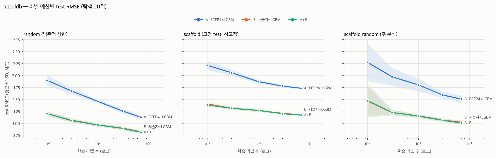

# 베이스라인 결과 — aqsoldb

- 결과 파일: `reports/results/aqsoldb_baselines_full.csv` · 주 지표 **RMSE** (작을수록 좋음) · 탐색 20회 체크포인트
- valid 정책 full: 학습 라벨 N개 + 하이퍼파라미터 선택용 valid(~10%)

## 1. 예산별 성능 (평균 ± SD, 시드 수)

### random (낙관적 상한)

| 라벨 수 | A  ECFP4+LGBM | B  서술자+LGBM | A+B |
|---:|---:|---:|---:|
| 100 | 1.899 ± 0.108 (10) | 1.200 ± 0.045 (10) | 1.204 ± 0.047 (10) |
| 300 | 1.677 ± 0.065 (10) | 1.065 ± 0.043 (10) | 1.056 ± 0.038 (10) |
| 1000 | 1.456 ± 0.034 (10) | 0.965 ± 0.027 (10) | 0.964 ± 0.032 (10) |
| 3000 | 1.260 ± 0.047 (10) | 0.898 ± 0.034 (10) | 0.893 ± 0.037 (10) |
| full | 1.127 ± 0.031 (10) | 0.822 ± 0.029 (10) | 0.812 ± 0.030 (10) |

### scaffold (고정 test, 참고점)

| 라벨 수 | A  ECFP4+LGBM | B  서술자+LGBM | A+B |
|---:|---:|---:|---:|
| 100 | 2.213 ± 0.095 (10) | 1.403 ± 0.036 (10) | 1.384 ± 0.036 (10) |
| 300 | 2.056 ± 0.062 (10) | 1.314 ± 0.034 (10) | 1.313 ± 0.024 (10) |
| 1000 | 1.872 ± 0.038 (10) | 1.267 ± 0.020 (10) | 1.269 ± 0.033 (10) |
| 3000 | 1.776 ± 0.024 (10) | 1.208 ± 0.011 (10) | 1.200 ± 0.018 (10) |
| full | 1.732 ± 0.020 (10) | 1.175 ± 0.016 (10) | 1.170 ± 0.013 (10) |

### scaffold_random (주 분석)

| 라벨 수 | A  ECFP4+LGBM | B  서술자+LGBM | A+B |
|---:|---:|---:|---:|
| 100 | 2.275 ± 0.390 (10) | 1.464 ± 0.302 (10) | 1.474 ± 0.351 (10) |
| 300 | 1.973 ± 0.185 (10) | 1.225 ± 0.052 (10) | 1.227 ± 0.057 (10) |
| 1000 | 1.802 ± 0.135 (10) | 1.153 ± 0.037 (10) | 1.148 ± 0.038 (10) |
| 3000 | 1.591 ± 0.064 (10) | 1.068 ± 0.028 (10) | 1.062 ± 0.039 (10) |
| full | 1.505 ± 0.076 (10) | 1.020 ± 0.044 (10) | 1.004 ± 0.039 (10) |

## 2. 시드 쌍 Wilcoxon (분할 내 예산 간 Holm 보정)

차이 = 앞 모델 − 뒤 모델의 RMSE. 음수면 앞 모델이 좋다.

| 분할 | 비교 | 라벨 수 | 중앙값 차이 | 쌍 | p | p (Holm) |
|---|---|---:|---:|---:|---:|---:|
| random | B_desc_lgbm − A_ecfp_lgbm | 100 | -0.683 | 10 | 0.0020 | 0.0098 |
| random | B_desc_lgbm − A_ecfp_lgbm | 300 | -0.616 | 10 | 0.0020 | 0.0098 |
| random | B_desc_lgbm − A_ecfp_lgbm | 1000 | -0.498 | 10 | 0.0020 | 0.0098 |
| random | B_desc_lgbm − A_ecfp_lgbm | 3000 | -0.368 | 10 | 0.0020 | 0.0098 |
| random | B_desc_lgbm − A_ecfp_lgbm | full | -0.301 | 10 | 0.0020 | 0.0098 |
| random | AB_ecfp_desc_lgbm − B_desc_lgbm | 100 | -0.004 | 10 | 0.6953 | 0.6953 |
| random | AB_ecfp_desc_lgbm − B_desc_lgbm | 300 | -0.004 | 10 | 0.1309 | 0.5234 |
| random | AB_ecfp_desc_lgbm − B_desc_lgbm | 1000 | -0.002 | 10 | 0.2754 | 0.5508 |
| random | AB_ecfp_desc_lgbm − B_desc_lgbm | 3000 | -0.009 | 10 | 0.1309 | 0.5234 |
| random | AB_ecfp_desc_lgbm − B_desc_lgbm | full | -0.012 | 10 | 0.0371 | 0.1855 |
| scaffold | B_desc_lgbm − A_ecfp_lgbm | 100 | -0.784 | 10 | 0.0020 | 0.0098 |
| scaffold | B_desc_lgbm − A_ecfp_lgbm | 300 | -0.745 | 10 | 0.0020 | 0.0098 |
| scaffold | B_desc_lgbm − A_ecfp_lgbm | 1000 | -0.597 | 10 | 0.0020 | 0.0098 |
| scaffold | B_desc_lgbm − A_ecfp_lgbm | 3000 | -0.558 | 10 | 0.0020 | 0.0098 |
| scaffold | B_desc_lgbm − A_ecfp_lgbm | full | -0.556 | 10 | 0.0020 | 0.0098 |
| scaffold | AB_ecfp_desc_lgbm − B_desc_lgbm | 100 | -0.022 | 10 | 0.0098 | 0.0488 |
| scaffold | AB_ecfp_desc_lgbm − B_desc_lgbm | 300 | 0.003 | 10 | 0.8457 | 0.9668 |
| scaffold | AB_ecfp_desc_lgbm − B_desc_lgbm | 1000 | -0.005 | 10 | 0.4316 | 0.9668 |
| scaffold | AB_ecfp_desc_lgbm − B_desc_lgbm | 3000 | -0.009 | 10 | 0.1055 | 0.4219 |
| scaffold | AB_ecfp_desc_lgbm − B_desc_lgbm | full | -0.005 | 10 | 0.3223 | 0.9668 |
| scaffold_random | B_desc_lgbm − A_ecfp_lgbm | 100 | -0.783 | 10 | 0.0020 | 0.0098 |
| scaffold_random | B_desc_lgbm − A_ecfp_lgbm | 300 | -0.677 | 10 | 0.0020 | 0.0098 |
| scaffold_random | B_desc_lgbm − A_ecfp_lgbm | 1000 | -0.588 | 10 | 0.0020 | 0.0098 |
| scaffold_random | B_desc_lgbm − A_ecfp_lgbm | 3000 | -0.531 | 10 | 0.0020 | 0.0098 |
| scaffold_random | B_desc_lgbm − A_ecfp_lgbm | full | -0.461 | 10 | 0.0020 | 0.0098 |
| scaffold_random | AB_ecfp_desc_lgbm − B_desc_lgbm | 100 | -0.011 | 10 | 0.9219 | 1.0000 |
| scaffold_random | AB_ecfp_desc_lgbm − B_desc_lgbm | 300 | -0.001 | 10 | 1.0000 | 1.0000 |
| scaffold_random | AB_ecfp_desc_lgbm − B_desc_lgbm | 1000 | -0.003 | 10 | 0.4922 | 1.0000 |
| scaffold_random | AB_ecfp_desc_lgbm − B_desc_lgbm | 3000 | -0.005 | 10 | 0.0840 | 0.3359 |
| scaffold_random | AB_ecfp_desc_lgbm − B_desc_lgbm | full | -0.010 | 10 | 0.0645 | 0.3223 |

## 3. 탐색 횟수 체크포인트 효과 (scaffold_random, 평균)

| 모델 | 라벨 수 | 5회 | 10회 | 20회 |
|---|---:|---:|---:|---:|
| A+B | 100 | 1.503 | 1.488 | 1.474 |
| A+B | 300 | 1.244 | 1.230 | 1.227 |
| A+B | 1000 | 1.170 | 1.154 | 1.148 |
| A+B | 3000 | 1.077 | 1.075 | 1.062 |
| A+B | full | 1.007 | 1.004 | 1.004 |
| A  ECFP4+LGBM | 100 | 2.277 | 2.294 | 2.275 |
| A  ECFP4+LGBM | 300 | 2.007 | 1.980 | 1.973 |
| A  ECFP4+LGBM | 1000 | 1.827 | 1.804 | 1.802 |
| A  ECFP4+LGBM | 3000 | 1.622 | 1.611 | 1.591 |
| A  ECFP4+LGBM | full | 1.541 | 1.507 | 1.505 |
| B  서술자+LGBM | 100 | 1.517 | 1.486 | 1.464 |
| B  서술자+LGBM | 300 | 1.249 | 1.227 | 1.225 |
| B  서술자+LGBM | 1000 | 1.178 | 1.173 | 1.153 |
| B  서술자+LGBM | 3000 | 1.082 | 1.075 | 1.068 |
| B  서술자+LGBM | full | 1.022 | 1.026 | 1.020 |

## 4. valid 민감도 (full vs proportional, 저예산)

| 분할 | 모델 | 라벨 수 | valid(prop) | full | proportional | 차이 | 쌍 |
|---|---|---:|---:|---:|---:|---:|---:|
| random | A+B | 100 | 12 | 1.204 | 1.295 | 0.091 | 10 |
| random | A+B | 300 | 38 | 1.056 | 1.090 | 0.034 | 10 |
| random | A  ECFP4+LGBM | 100 | 12 | 1.899 | 2.042 | 0.143 | 10 |
| random | A  ECFP4+LGBM | 300 | 38 | 1.677 | 1.760 | 0.083 | 10 |
| random | B  서술자+LGBM | 100 | 12 | 1.200 | 1.265 | 0.065 | 10 |
| random | B  서술자+LGBM | 300 | 38 | 1.065 | 1.093 | 0.029 | 10 |
| scaffold | A+B | 100 | 12 | 1.384 | 1.456 | 0.071 | 10 |
| scaffold | A+B | 300 | 38 | 1.313 | 1.338 | 0.025 | 10 |
| scaffold | A  ECFP4+LGBM | 100 | 12 | 2.213 | 2.292 | 0.079 | 10 |
| scaffold | A  ECFP4+LGBM | 300 | 38 | 2.056 | 2.111 | 0.055 | 10 |
| scaffold | B  서술자+LGBM | 100 | 12 | 1.403 | 1.447 | 0.044 | 10 |
| scaffold | B  서술자+LGBM | 300 | 38 | 1.314 | 1.343 | 0.029 | 10 |
| scaffold_random | A+B | 100 | 12 | 1.474 | 1.545 | 0.072 | 10 |
| scaffold_random | A+B | 300 | 38 | 1.227 | 1.261 | 0.035 | 10 |
| scaffold_random | A  ECFP4+LGBM | 100 | 12 | 2.275 | 2.347 | 0.072 | 10 |
| scaffold_random | A  ECFP4+LGBM | 300 | 38 | 1.973 | 2.001 | 0.028 | 10 |
| scaffold_random | B  서술자+LGBM | 100 | 12 | 1.464 | 1.493 | 0.029 | 10 |
| scaffold_random | B  서술자+LGBM | 300 | 38 | 1.225 | 1.254 | 0.029 | 10 |

proportional에서의 B − A Wilcoxon:

| 분할 | 라벨 수 | 중앙값 차이 | p (Holm) |
|---|---:|---:|---:|
| random | 100 | -0.724 | 0.0039 |
| random | 300 | -0.685 | 0.0039 |
| scaffold | 100 | -0.828 | 0.0039 |
| scaffold | 300 | -0.752 | 0.0039 |
| scaffold_random | 100 | -0.848 | 0.0039 |
| scaffold_random | 300 | -0.690 | 0.0039 |
