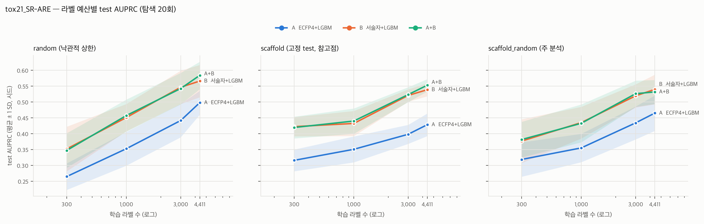

# 베이스라인 결과 — tox21_SR-ARE

- 결과 파일: `reports/results/tox21_SR-ARE_baselines_full.csv` · 주 지표 **AUPRC** (클수록 좋음) · 탐색 20회 체크포인트
- valid 정책 full: 학습 라벨 N개 + 하이퍼파라미터 선택용 valid(~10%)

## 1. 예산별 성능 (평균 ± SD, 시드 수)

### random (낙관적 상한)

| 라벨 수 | A  ECFP4+LGBM | B  서술자+LGBM | A+B |
|---:|---:|---:|---:|
| 300 | 0.265 ± 0.042 (10) | 0.352 ± 0.070 (10) | 0.347 ± 0.055 (10) |
| 1000 | 0.353 ± 0.053 (10) | 0.451 ± 0.043 (10) | 0.457 ± 0.051 (10) |
| 3000 | 0.442 ± 0.053 (10) | 0.546 ± 0.053 (10) | 0.542 ± 0.050 (10) |
| full | 0.498 ± 0.038 (10) | 0.566 ± 0.051 (10) | 0.584 ± 0.043 (10) |

### scaffold (고정 test, 참고점)

| 라벨 수 | A  ECFP4+LGBM | B  서술자+LGBM | A+B |
|---:|---:|---:|---:|
| 300 | 0.316 ± 0.034 (10) | 0.422 ± 0.030 (10) | 0.420 ± 0.034 (10) |
| 1000 | 0.351 ± 0.041 (10) | 0.432 ± 0.039 (10) | 0.440 ± 0.040 (10) |
| 3000 | 0.398 ± 0.030 (10) | 0.521 ± 0.019 (10) | 0.523 ± 0.024 (10) |
| full | 0.428 ± 0.036 (10) | 0.539 ± 0.021 (10) | 0.553 ± 0.019 (10) |

### scaffold_random (주 분석)

| 라벨 수 | A  ECFP4+LGBM | B  서술자+LGBM | A+B |
|---:|---:|---:|---:|
| 300 | 0.319 ± 0.054 (10) | 0.377 ± 0.069 (10) | 0.381 ± 0.056 (10) |
| 1000 | 0.355 ± 0.045 (10) | 0.435 ± 0.050 (10) | 0.433 ± 0.060 (10) |
| 3000 | 0.434 ± 0.052 (10) | 0.519 ± 0.037 (10) | 0.526 ± 0.041 (10) |
| full | 0.465 ± 0.056 (10) | 0.540 ± 0.047 (10) | 0.532 ± 0.038 (10) |

## 2. 시드 쌍 Wilcoxon (분할 내 예산 간 Holm 보정)

차이 = 앞 모델 − 뒤 모델의 AUPRC. 양수면 앞 모델이 좋다.

| 분할 | 비교 | 라벨 수 | 중앙값 차이 | 쌍 | p | p (Holm) |
|---|---|---:|---:|---:|---:|---:|
| random | B_desc_lgbm − A_ecfp_lgbm | 300 | 0.089 | 10 | 0.0020 | 0.0078 |
| random | B_desc_lgbm − A_ecfp_lgbm | 1000 | 0.132 | 10 | 0.0039 | 0.0078 |
| random | B_desc_lgbm − A_ecfp_lgbm | 3000 | 0.093 | 10 | 0.0020 | 0.0078 |
| random | B_desc_lgbm − A_ecfp_lgbm | full | 0.071 | 10 | 0.0020 | 0.0078 |
| random | AB_ecfp_desc_lgbm − B_desc_lgbm | 300 | -0.001 | 10 | 0.9219 | 1.0000 |
| random | AB_ecfp_desc_lgbm − B_desc_lgbm | 1000 | -0.001 | 10 | 0.7695 | 1.0000 |
| random | AB_ecfp_desc_lgbm − B_desc_lgbm | 3000 | -0.001 | 10 | 0.6953 | 1.0000 |
| random | AB_ecfp_desc_lgbm − B_desc_lgbm | full | 0.018 | 10 | 0.0840 | 0.3359 |
| scaffold | B_desc_lgbm − A_ecfp_lgbm | 300 | 0.105 | 10 | 0.0020 | 0.0078 |
| scaffold | B_desc_lgbm − A_ecfp_lgbm | 1000 | 0.077 | 10 | 0.0020 | 0.0078 |
| scaffold | B_desc_lgbm − A_ecfp_lgbm | 3000 | 0.117 | 10 | 0.0020 | 0.0078 |
| scaffold | B_desc_lgbm − A_ecfp_lgbm | full | 0.103 | 10 | 0.0020 | 0.0078 |
| scaffold | AB_ecfp_desc_lgbm − B_desc_lgbm | 300 | -0.008 | 10 | 0.6953 | 0.9844 |
| scaffold | AB_ecfp_desc_lgbm − B_desc_lgbm | 1000 | 0.015 | 10 | 0.3223 | 0.9668 |
| scaffold | AB_ecfp_desc_lgbm − B_desc_lgbm | 3000 | 0.003 | 10 | 0.4922 | 0.9844 |
| scaffold | AB_ecfp_desc_lgbm − B_desc_lgbm | full | 0.016 | 10 | 0.0645 | 0.2578 |
| scaffold_random | B_desc_lgbm − A_ecfp_lgbm | 300 | 0.054 | 10 | 0.0039 | 0.0078 |
| scaffold_random | B_desc_lgbm − A_ecfp_lgbm | 1000 | 0.082 | 10 | 0.0020 | 0.0078 |
| scaffold_random | B_desc_lgbm − A_ecfp_lgbm | 3000 | 0.082 | 10 | 0.0020 | 0.0078 |
| scaffold_random | B_desc_lgbm − A_ecfp_lgbm | full | 0.087 | 10 | 0.0059 | 0.0078 |
| scaffold_random | AB_ecfp_desc_lgbm − B_desc_lgbm | 300 | 0.001 | 10 | 0.9219 | 1.0000 |
| scaffold_random | AB_ecfp_desc_lgbm − B_desc_lgbm | 1000 | -0.006 | 10 | 0.6953 | 1.0000 |
| scaffold_random | AB_ecfp_desc_lgbm − B_desc_lgbm | 3000 | 0.004 | 10 | 0.3223 | 1.0000 |
| scaffold_random | AB_ecfp_desc_lgbm − B_desc_lgbm | full | -0.009 | 10 | 0.4316 | 1.0000 |

## 3. 탐색 횟수 체크포인트 효과 (scaffold_random, 평균)

| 모델 | 라벨 수 | 5회 | 10회 | 20회 |
|---|---:|---:|---:|---:|
| A+B | 300 | 0.385 | 0.379 | 0.381 |
| A+B | 1000 | 0.438 | 0.442 | 0.433 |
| A+B | 3000 | 0.524 | 0.512 | 0.526 |
| A+B | full | 0.522 | 0.532 | 0.532 |
| A  ECFP4+LGBM | 300 | 0.313 | 0.322 | 0.319 |
| A  ECFP4+LGBM | 1000 | 0.339 | 0.355 | 0.355 |
| A  ECFP4+LGBM | 3000 | 0.426 | 0.434 | 0.434 |
| A  ECFP4+LGBM | full | 0.458 | 0.477 | 0.465 |
| B  서술자+LGBM | 300 | 0.384 | 0.383 | 0.377 |
| B  서술자+LGBM | 1000 | 0.444 | 0.444 | 0.435 |
| B  서술자+LGBM | 3000 | 0.523 | 0.519 | 0.519 |
| B  서술자+LGBM | full | 0.532 | 0.538 | 0.540 |

## 4. valid 민감도 (full vs proportional, 저예산)

| 분할 | 모델 | 라벨 수 | valid(prop) | full | proportional | 차이 | 쌍 |
|---|---|---:|---:|---:|---:|---:|---:|
| random | A+B | 300 | 38 | 0.347 | 0.347 | -0.001 | 10 |
| random | A  ECFP4+LGBM | 300 | 38 | 0.265 | 0.243 | -0.022 | 10 |
| random | B  서술자+LGBM | 300 | 38 | 0.352 | 0.336 | -0.016 | 10 |
| scaffold | A+B | 300 | 38 | 0.420 | 0.416 | -0.004 | 10 |
| scaffold | A  ECFP4+LGBM | 300 | 38 | 0.316 | 0.306 | -0.010 | 10 |
| scaffold | B  서술자+LGBM | 300 | 38 | 0.422 | 0.412 | -0.010 | 10 |
| scaffold_random | A+B | 300 | 38 | 0.381 | 0.366 | -0.016 | 10 |
| scaffold_random | A  ECFP4+LGBM | 300 | 38 | 0.319 | 0.292 | -0.027 | 10 |
| scaffold_random | B  서술자+LGBM | 300 | 38 | 0.377 | 0.367 | -0.010 | 10 |

proportional에서의 B − A Wilcoxon:

| 분할 | 라벨 수 | 중앙값 차이 | p (Holm) |
|---|---:|---:|---:|
| random | 300 | 0.096 | 0.0020 |
| scaffold | 300 | 0.120 | 0.0020 |
| scaffold_random | 300 | 0.069 | 0.0020 |

## 5. 분류 보조: 양성 수와 AUROC

AUPRC의 무작위 기준선은 test 양성률이다. AUROC는 불균형에서 낙관적이므로 양성률과 함께 읽는다. test 양성 20개 미만 조합은 신뢰할 수 없다(02 §8).

### random (낙관적 상한)

| 라벨 수 | test 양성 | train 양성 | 양성 20개 미만 | test 양성률 | AUROC A  ECFP4+LGBM | AUROC B  서술자+LGBM | AUROC A+B |
|---:|---:|---:|---:|---:|---:|---:|---:|
| 300 | 74~98 | 47~48 | 0/10 | 15.3% | 0.642 | 0.737 | 0.737 |
| 1000 | 74~98 | 156~161 | 0/10 | 15.3% | 0.728 | 0.798 | 0.793 |
| 3000 | 74~98 | 467~484 | 0/10 | 15.3% | 0.773 | 0.836 | 0.838 |
| full | 74~98 | 686~711 | 0/10 | 15.3% | 0.802 | 0.845 | 0.853 |

### scaffold (고정 test, 참고점)

| 라벨 수 | test 양성 | train 양성 | 양성 20개 미만 | test 양성률 | AUROC A  ECFP4+LGBM | AUROC B  서술자+LGBM | AUROC A+B |
|---:|---:|---:|---:|---:|---:|---:|---:|
| 300 | 135~135 | 42~42 | 0/10 | 24.5% | 0.571 | 0.673 | 0.679 |
| 1000 | 135~135 | 139~139 | 0/10 | 24.5% | 0.622 | 0.689 | 0.696 |
| 3000 | 135~135 | 416~416 | 0/10 | 24.5% | 0.686 | 0.767 | 0.768 |
| full | 135~135 | 612~612 | 0/10 | 24.5% | 0.706 | 0.783 | 0.789 |

### scaffold_random (주 분석)

| 라벨 수 | test 양성 | train 양성 | 양성 20개 미만 | test 양성률 | AUROC A  ECFP4+LGBM | AUROC B  서술자+LGBM | AUROC A+B |
|---:|---:|---:|---:|---:|---:|---:|---:|
| 300 | 90~125 | 41~45 | 0/10 | 20.4% | 0.636 | 0.704 | 0.709 |
| 1000 | 90~125 | 136~152 | 0/10 | 20.4% | 0.669 | 0.747 | 0.743 |
| 3000 | 90~125 | 409~455 | 0/10 | 20.4% | 0.731 | 0.794 | 0.793 |
| full | 90~125 | 601~669 | 0/10 | 20.4% | 0.751 | 0.806 | 0.807 |
