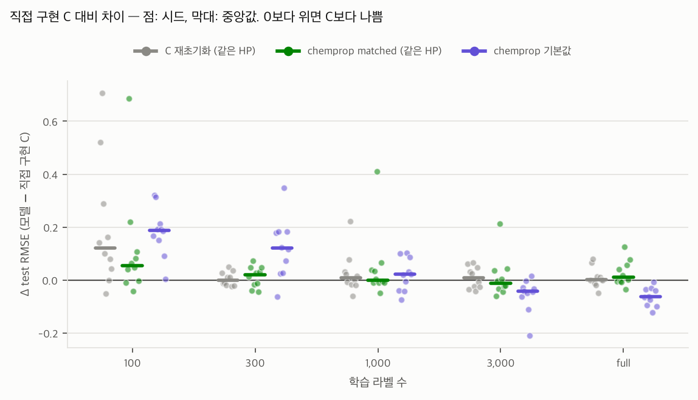

# Chemprop 재현 (G4-b) — aqsoldb

- 분할 scaffold_random, 시드 10개 × 예산 5개, 주 지표 test RMSE
- 공식 chemprop 2.3.1 CLI (`labelbudget-equiv` 환경)에 우리 분할·서브샘플 인덱스를 그대로 넣었다 (`scripts/reproduce_chemprop.py`). 예측은 우리 지표 함수로 다시 계산했다
- **matched**: C가 탐색 20회로 고른 HP + C의 학습 규칙 (고정 lr, mean readout, 최대 100에폭, valid RMSE patience 10)
- **재초기화**: 직접 구현 C를 같은 HP로, 초기화·셔플 시드만 바꿔 재학습 → 같은 구현 안의 잡음 바닥
- **chemprop 기본값**: HP 탐색 없음 (hidden 300, depth 3, FFN 300×1, dropout 0, 50에폭, Noam lr 1e-4→1e-3→1e-4, norm readout, valid loss 최저 체크포인트)

## 1. 예산별 RMSE (평균 ± SD / 중앙값)

| 라벨 수 | C 직접 구현 (탐색 20회) | C 재초기화 (같은 HP) | chemprop matched (같은 HP) | chemprop 기본값 | B 서술자+LGBM |
|---:|---:|---:|---:|---:|---:|
| 100 | 1.760 ± 0.282 / 1.684 | 1.959 ± 0.331 / 1.846 | 1.879 ± 0.283 / 1.773 | 1.943 ± 0.288 / 1.855 | 1.464 ± 0.302 / 1.390 |
| 300 | 1.394 ± 0.083 / 1.387 | 1.399 ± 0.075 / 1.405 | 1.407 ± 0.111 / 1.392 | 1.514 ± 0.092 / 1.534 | 1.225 ± 0.052 / 1.207 |
| 1000 | 1.255 ± 0.061 / 1.258 | 1.281 ± 0.133 / 1.265 | 1.301 ± 0.179 / 1.273 | 1.275 ± 0.075 / 1.305 | 1.153 ± 0.037 / 1.162 |
| 3000 | 1.153 ± 0.039 / 1.162 | 1.163 ± 0.056 / 1.159 | 1.165 ± 0.102 / 1.128 | 1.097 ± 0.074 / 1.120 | 1.068 ± 0.028 / 1.062 |
| full | 1.060 ± 0.041 / 1.066 | 1.069 ± 0.055 / 1.075 | 1.087 ± 0.055 / 1.073 | 0.997 ± 0.039 / 1.004 | 1.020 ± 0.044 / 1.026 |

## 2. 구현 검증: 같은 HP에서 구현을 바꾼 차이 vs 초기화만 바꾼 차이

| 라벨 수 | \|matched − C\| 중앙값 | \|재초기화 − C\| 중앙값 | matched − C 중앙값 | p (Holm) | 재초기화 − C 중앙값 | p (Holm) |
|---:|---:|---:|---:|---:|---:|---:|
| 100 | 0.055 | 0.121 | 0.055 | 0.1855 | 0.121 | 0.0684 |
| 300 | 0.035 | 0.020 | 0.020 | 0.9668 | -0.001 | 1.0000 |
| 1000 | 0.022 | 0.020 | -0.001 | 1.0000 | 0.008 | 1.0000 |
| 3000 | 0.035 | 0.033 | -0.011 | 1.0000 | 0.008 | 1.0000 |
| full | 0.026 | 0.013 | 0.010 | 0.9297 | 0.001 | 1.0000 |

matched − 재초기화 (둘 다 'C와 같은 HP, 다른 난수'. 구현만 다르다):

| 라벨 수 | 중앙값 차이 | p (Holm) |
|---:|---:|---:|
| 100 | -0.042 | 0.5273 |
| 300 | -0.017 | 1.0000 |
| 1000 | 0.010 | 1.0000 |
| 3000 | -0.018 | 1.0000 |
| full | 0.009 | 1.0000 |

## 3. 실무 기준점: chemprop 기본값 vs 탐색한 C, vs B

| 라벨 수 | 기본값 − C 중앙값 | p (Holm) | 기본값 − B 중앙값 | p (Holm) | B가 이긴 시드 |
|---:|---:|---:|---:|---:|---:|
| 100 | 0.188 | 0.0098 | 0.465 | 0.0098 | 10/10 |
| 300 | 0.121 | 0.0195 | 0.287 | 0.0098 | 10/10 |
| 1000 | 0.021 | 0.4316 | 0.140 | 0.0098 | 10/10 |
| 3000 | -0.043 | 0.0176 | 0.047 | 0.2324 | 8/10 |
| full | -0.064 | 0.0098 | -0.027 | 0.2109 | 2/10 |

## 4. 학습 길이와 시간 (1스레드, 6프로세스 동시 실행)

| 모델 | 라벨 수 | 에폭 중앙값 | 1회 학습 평균 (분) |
|---|---:|---:|---:|
| chemprop 기본값 | 100 | 50 | 1.1 |
| chemprop 기본값 | 300 | 50 | 1.3 |
| chemprop 기본값 | 1000 | 50 | 1.9 |
| chemprop 기본값 | 3000 | 50 | 3.8 |
| chemprop 기본값 | full | 50 | 9.0 |
| chemprop matched (같은 HP) | 100 | 52 | 1.5 |
| chemprop matched (같은 HP) | 300 | 59 | 1.7 |
| chemprop matched (같은 HP) | 1000 | 41 | 2.3 |
| chemprop matched (같은 HP) | 3000 | 34 | 2.7 |
| chemprop matched (같은 HP) | full | 50 | 12.4 |
| C 재초기화 (같은 HP) | 100 | 42 | 5.0 |
| C 재초기화 (같은 HP) | 300 | 66 | 13.4 |
| C 재초기화 (같은 HP) | 1000 | 36 | 16.4 |
| C 재초기화 (같은 HP) | 3000 | 36 | 16.5 |
| C 재초기화 (같은 HP) | full | 38 | 45.2 |
