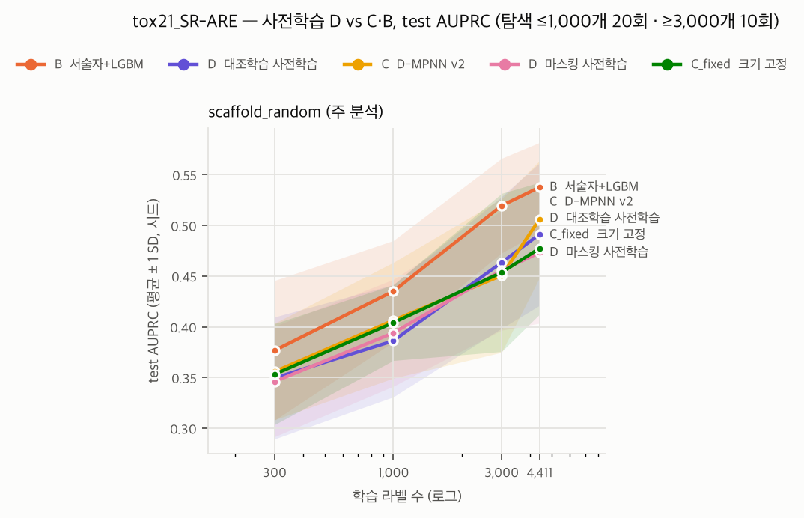

# D(사전학습) 결과 — tox21_SR-ARE · scaffold_random (주 분석)

- 판정 규칙: `docs/design/05_PRETRAIN_SPEC.md` §4 (결과 전 고정, 커밋 3f50a0f). 주 지표 **AUPRC** (클수록 좋음)
- 탐색 횟수: 라벨 ≤1,000개는 20회, ≥3,000개는 10회 체크포인트. 모든 모델이 같은 체크포인트 (05 §2.2 T1)
- 포함 모델: B  서술자+LGBM, C  D-MPNN v2, C_fixed  크기 고정, D  마스킹 사전학습, D  대조학습 사전학습. 모든 GNN 행이 같은 (시드, 예산, 체크포인트)의 B 행과 크기 일치
- 미세조정: CPU 결정론, 프로세스 1스레드. 사전학습 가중치 SHA-256은 각 행의 config_hash에 들어 있다

## 1. 예산별 성능 (평균 ± SD, 시드 수)

| 라벨 수 | B  서술자+LGBM | C  D-MPNN v2 | C_fixed  크기 고정 | D  마스킹 사전학습 | D  대조학습 사전학습 |
|---:|---:|---:|---:|---:|---:|
| 300 | 0.377 ± 0.069 (10) | 0.356 ± 0.048 (10) | 0.353 ± 0.050 (10) | 0.346 ± 0.054 (10) | 0.350 ± 0.060 (10) |
| 1000 | 0.435 ± 0.050 (10) | 0.406 ± 0.057 (10) | 0.404 ± 0.037 (10) | 0.394 ± 0.053 (10) | 0.386 ± 0.055 (10) |
| 3000 | 0.519 ± 0.047 (10) | 0.451 ± 0.076 (10) | 0.454 ± 0.078 (10) | 0.456 ± 0.059 (10) | 0.463 ± 0.065 (10) |
| full | 0.538 ± 0.044 (10) | 0.506 ± 0.058 (10) | 0.477 ± 0.065 (10) | 0.473 ± 0.070 (10) | 0.491 ± 0.070 (10) |

## 2. 사전 등록 비교 (시드 쌍 Wilcoxon, 비교마다 예산 간 Holm)

차이 = D − 비교 대상의 AUPRC. 양수면 D가 낫다. 'D 승'은 D가 이긴 시드 수.

### D  마스킹 사전학습 − C_fixed  크기 고정

| 라벨 수 | 쌍 | 중앙값 차이 | D 승 | p | p (Holm) |
|---:|---:|---:|---:|---:|---:|
| 300 | 10 | 0.009 | 6/10 | 1.0000 | 1.0000 |
| 1000 | 10 | 0.008 | 6/10 | 0.9219 | 1.0000 |
| 3000 | 10 | -0.013 | 4/10 | 0.7695 | 1.0000 |
| full | 10 | -0.000 | 5/10 | 0.6953 | 1.0000 |

### D  마스킹 사전학습 − C  D-MPNN v2

| 라벨 수 | 쌍 | 중앙값 차이 | D 승 | p | p (Holm) |
|---:|---:|---:|---:|---:|---:|
| 300 | 10 | -0.012 | 4/10 | 0.5566 | 1.0000 |
| 1000 | 10 | 0.002 | 5/10 | 0.6250 | 1.0000 |
| 3000 | 10 | -0.011 | 3/10 | 0.5566 | 1.0000 |
| full | 10 | -0.020 | 1/10 | 0.0039 | 0.0156 |

### D  마스킹 사전학습 − B  서술자+LGBM

| 라벨 수 | 쌍 | 중앙값 차이 | D 승 | p | p (Holm) |
|---:|---:|---:|---:|---:|---:|
| 300 | 10 | -0.025 | 1/10 | 0.0645 | 0.0645 |
| 1000 | 10 | -0.052 | 3/10 | 0.0273 | 0.0547 |
| 3000 | 10 | -0.058 | 1/10 | 0.0059 | 0.0234 |
| full | 10 | -0.076 | 2/10 | 0.0137 | 0.0410 |

### D  대조학습 사전학습 − C_fixed  크기 고정

| 라벨 수 | 쌍 | 중앙값 차이 | D 승 | p | p (Holm) |
|---:|---:|---:|---:|---:|---:|
| 300 | 10 | -0.005 | 4/10 | 0.6953 | 1.0000 |
| 1000 | 10 | -0.021 | 3/10 | 0.2754 | 1.0000 |
| 3000 | 10 | -0.011 | 4/10 | 0.6250 | 1.0000 |
| full | 10 | 0.011 | 6/10 | 0.4922 | 1.0000 |

### D  대조학습 사전학습 − C  D-MPNN v2

| 라벨 수 | 쌍 | 중앙값 차이 | D 승 | p | p (Holm) |
|---:|---:|---:|---:|---:|---:|
| 300 | 10 | -0.010 | 3/10 | 0.6250 | 1.0000 |
| 1000 | 10 | -0.021 | 3/10 | 0.2754 | 1.0000 |
| 3000 | 10 | -0.001 | 5/10 | 0.6953 | 1.0000 |
| full | 10 | 0.005 | 5/10 | 0.6250 | 1.0000 |

### D  대조학습 사전학습 − B  서술자+LGBM

| 라벨 수 | 쌍 | 중앙값 차이 | D 승 | p | p (Holm) |
|---:|---:|---:|---:|---:|---:|
| 300 | 10 | -0.021 | 3/10 | 0.2324 | 0.2324 |
| 1000 | 10 | -0.050 | 1/10 | 0.0137 | 0.0547 |
| 3000 | 10 | -0.060 | 3/10 | 0.0273 | 0.0820 |
| full | 10 | -0.043 | 2/10 | 0.0371 | 0.0820 |

## 3. 가설 판정 (05 §4 규칙 그대로)

### D  마스킹 사전학습

- **H1** (D − C_fixed 이득이 예산이 늘수록 줄어드는가, 기술만): 이득 중앙값 300 +0.009 → 1000 +0.008 → 3000 -0.013 → full -0.000 — 단조 감소 아님
- **H2** (교차점): D 우세로 유의한 가장 큰 예산 없음, B 우세로 유의한 가장 작은 예산 3000
- **H4** (구조 탐색 효과와 함께 보기): 예산별 이득 중앙값 D − C_fixed / D − C v2 = 300 +0.009 / -0.012, 1000 +0.008 / +0.002, 3000 -0.013 / -0.011, full -0.000 / -0.020

### D  대조학습 사전학습

- **H1** (D − C_fixed 이득이 예산이 늘수록 줄어드는가, 기술만): 이득 중앙값 300 -0.005 → 1000 -0.021 → 3000 -0.011 → full +0.011 — 단조 감소 아님
- **H2** (교차점): 교차점 없음 (D·B 어느 쪽도 Holm 유의한 예산 없음)
- **H4** (구조 탐색 효과와 함께 보기): 예산별 이득 중앙값 D − C_fixed / D − C v2 = 300 -0.005 / -0.010, 1000 -0.021 / -0.021, 3000 -0.011 / -0.001, full +0.011 / +0.005

### 구조 탐색 효과: C v2 − C_fixed (같은 공간에서 d_h·depth를 탐색한 효과)

| 라벨 수 | 중앙값 차이 | C v2 승 | p (Holm) |
|---:|---:|---:|---:|
| 300 | 0.003 | 5/10 | 1.0000 |
| 1000 | 0.000 | 5/10 | 1.0000 |
| 3000 | -0.002 | 5/10 | 1.0000 |
| full | 0.035 | 8/10 | 0.0781 |

## 4. H3·불확실성·앱에 쓸 D (05 §2.2 U1, valid만 사용)

예산별 시드 평균 valid 점수 차이(D_mask − D_contrast): 300 +0.0195, 1000 -0.0030, 3000 +0.0071, full +0.0039 → 예산 평균 +0.0069 → **D_mask**

## 5. 보조: 큰 예산의 탐색 10회 vs 20회 (C v2 − B)

T1 민감도. 20회 값은 이전 보고서(gnn_v2_*)와 같다. Holm은 두 예산 안에서만 보정한 값이다.

| 라벨 수 | 10회 중앙값 차이 | p (Holm) | 20회 중앙값 차이 | p (Holm) |
|---:|---:|---:|---:|---:|
| 3000 | -0.049 | 0.0117 | -0.049 | 0.0078 |
| full | -0.038 | 0.0840 | -0.029 | 0.0645 |

## 사전학습 기록

| 방법 | 가중치 SHA-256 | 에폭 | 마지막 train 손실 | 마지막 valid 손실 | valid 정확도 | 총 시간 (h) |
|---|---|---:|---:|---:|---:|---:|
| D_mask | `c60b22e0c48e8548…` | 100 | 0.1363 | 0.1399 | 0.944 | 1.7 |
| D_contrast | `75d3db57b2db8777…` | 100 | -2.9242 | -2.9343 | 0.996 | 3.3 |

valid 정확도: 마스킹은 가린 원자의 종류 정답률, 대조학습은 배치 안에서 짝 뷰를 가장 가깝게 찾은 비율.

## 실행 시간 (조합당 분, 1스레드 프로세스 4~6개 동시 실행)

다른 앱의 CPU 경합이 있던 시간대 값이 섞여 있다. 비용 추정에는 경합이 없던 조합만 쓴다.

| 모델 | 300 | 1000 | 3000 | full |
|---|---:|---:|---:|---:|
| D  대조학습 사전학습 | 3.9 | 8.3 | 11.3 | 16.8 |
| C  D-MPNN v2 | 5.3 | 13.2 | 40.4 | 57.0 |
| D  마스킹 사전학습 | 3.3 | 7.9 | 11.8 | 16.6 |
| C_fixed  크기 고정 | 5.7 | 15.9 | 23.2 | 32.4 |
