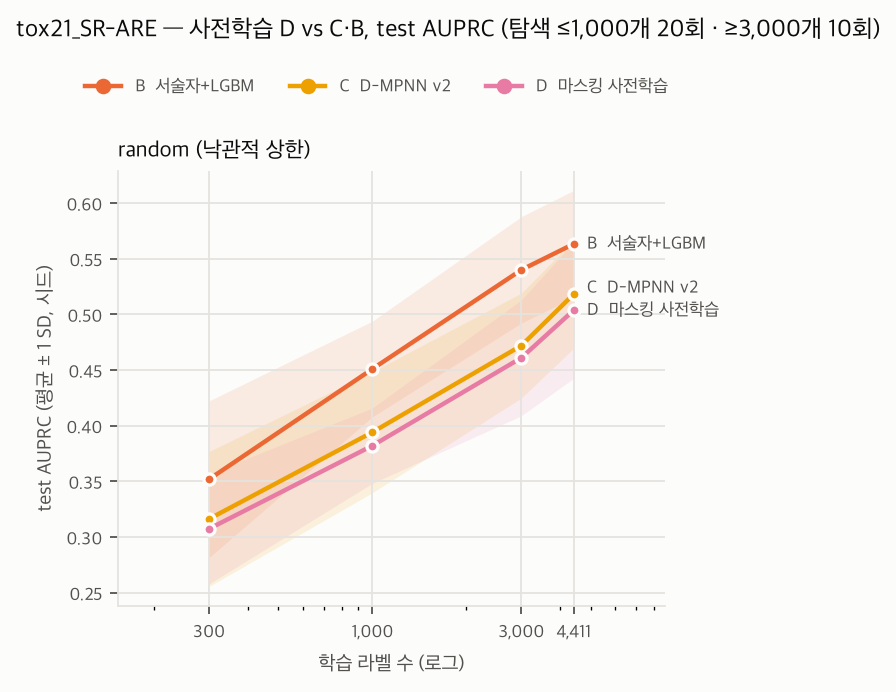

# D(사전학습) 결과 — tox21_SR-ARE · random (낙관적 상한)

- 판정 규칙: `docs/design/05_PRETRAIN_SPEC.md` §4 (결과 전 고정, 커밋 3f50a0f). 주 지표 **AUPRC** (클수록 좋음)
- 탐색 횟수: 라벨 ≤1,000개는 20회, ≥3,000개는 10회 체크포인트. 모든 모델이 같은 체크포인트 (05 §2.2 T1)
- 포함 모델: B  서술자+LGBM, C  D-MPNN v2, D  마스킹 사전학습. 모든 GNN 행이 같은 (시드, 예산, 체크포인트)의 B 행과 크기 일치
- 미세조정: CPU 결정론, 프로세스 1스레드. 사전학습 가중치 SHA-256은 각 행의 config_hash에 들어 있다

## 1. 예산별 성능 (평균 ± SD, 시드 수)

| 라벨 수 | B  서술자+LGBM | C  D-MPNN v2 | D  마스킹 사전학습 |
|---:|---:|---:|---:|
| 300 | 0.352 ± 0.070 (10) | 0.316 ± 0.061 (10) | 0.307 ± 0.049 (10) |
| 1000 | 0.451 ± 0.043 (10) | 0.394 ± 0.054 (10) | 0.382 ± 0.034 (10) |
| 3000 | 0.540 ± 0.048 (10) | 0.472 ± 0.047 (10) | 0.461 ± 0.052 (10) |
| full | 0.563 ± 0.048 (10) | 0.518 ± 0.049 (10) | 0.504 ± 0.061 (10) |

## 2. 사전 등록 비교 (시드 쌍 Wilcoxon, 비교마다 예산 간 Holm)

차이 = D − 비교 대상의 AUPRC. 양수면 D가 낫다. 'D 승'은 D가 이긴 시드 수.

### D  마스킹 사전학습 − C  D-MPNN v2

| 라벨 수 | 쌍 | 중앙값 차이 | D 승 | p | p (Holm) |
|---:|---:|---:|---:|---:|---:|
| 300 | 10 | -0.003 | 5/10 | 0.7695 | 0.9844 |
| 1000 | 10 | -0.013 | 3/10 | 0.2754 | 0.8262 |
| 3000 | 10 | -0.011 | 2/10 | 0.1309 | 0.5234 |
| full | 10 | -0.004 | 4/10 | 0.4922 | 0.9844 |

### D  마스킹 사전학습 − B  서술자+LGBM

| 라벨 수 | 쌍 | 중앙값 차이 | D 승 | p | p (Holm) |
|---:|---:|---:|---:|---:|---:|
| 300 | 10 | -0.056 | 2/10 | 0.0137 | 0.0273 |
| 1000 | 10 | -0.053 | 0/10 | 0.0020 | 0.0078 |
| 3000 | 10 | -0.072 | 1/10 | 0.0039 | 0.0117 |
| full | 10 | -0.053 | 2/10 | 0.0137 | 0.0273 |

## 3. 가설 판정 (05 §4 규칙 그대로)

### D  마스킹 사전학습

- **H2** (교차점): D 우세로 유의한 가장 큰 예산 없음, B 우세로 유의한 가장 작은 예산 300

## 4. H3: 교차점이 분할에 따라 이동하는가 (05 §2.2 U1, 기술만)

H2 규칙을 scaffold_random과 random (낙관적 상한)에 똑같이 적용했다. 가설은 "교차점이 random보다 scaffold에서 오른쪽"이다.

| 모델 − B | scaffold_random | random |
|---|---|---|
| C  D-MPNN v2 | C 우세로 유의한 가장 큰 예산 없음, B 우세로 유의한 가장 작은 예산 3000 | C 우세로 유의한 가장 큰 예산 없음, B 우세로 유의한 가장 작은 예산 1000 |
| D  마스킹 사전학습 | D 우세로 유의한 가장 큰 예산 없음, B 우세로 유의한 가장 작은 예산 3000 | D 우세로 유의한 가장 큰 예산 없음, B 우세로 유의한 가장 작은 예산 300 |

## 사전학습 기록

| 방법 | 가중치 SHA-256 | 에폭 | 마지막 train 손실 | 마지막 valid 손실 | valid 정확도 | 총 시간 (h) |
|---|---|---:|---:|---:|---:|---:|
| D_mask | `c60b22e0c48e8548…` | 100 | 0.1363 | 0.1399 | 0.944 | 1.7 |
| D_contrast | `75d3db57b2db8777…` | 100 | -2.9242 | -2.9343 | 0.996 | 3.3 |

valid 정확도: 마스킹은 가린 원자의 종류 정답률, 대조학습은 배치 안에서 짝 뷰를 가장 가깝게 찾은 비율.

## 실행 시간 (조합당 분, 1스레드 프로세스 4~6개 동시 실행)

다른 앱의 CPU 경합이 있던 시간대 값이 섞여 있다. 비용 추정에는 경합이 없던 조합만 쓴다.

| 모델 | 300 | 1000 | 3000 | full |
|---|---:|---:|---:|---:|
| C  D-MPNN v2 | 5.7 | 15.9 | 24.3 | 29.2 |
| D  마스킹 사전학습 | 6.3 | 14.1 | 20.4 | 22.3 |
