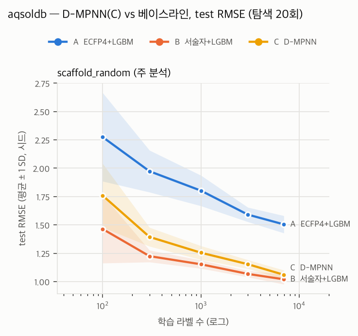

# GNN(C) 결과 — aqsoldb

- 결과 파일: `reports/results/aqsoldb_gnn_full.csv` + `reports/results/aqsoldb_baselines_full.csv` · 분할 **scaffold_random** · 주 지표 **RMSE** (작을수록 좋음) · 탐색 20회 체크포인트
- 정렬 확인: C 행 900개 모두 같은 (시드, 예산, 체크포인트)의 B 행과 n_train·n_valid·n_test 일치
- C 실행 조건: CPU 결정론 모드, 프로세스 6개 × 1스레드 (결정 G3·G5). 베이스라인은 LightGBM 8스레드

## 1. 예산별 성능 (평균 ± SD, 시드 수)

### scaffold_random (주 분석)

| 라벨 수 | A  ECFP4+LGBM | B  서술자+LGBM | C  D-MPNN |
|---:|---:|---:|---:|
| 100 | 2.275 ± 0.390 (10) | 1.464 ± 0.302 (10) | 1.760 ± 0.282 (10) |
| 300 | 1.973 ± 0.185 (10) | 1.225 ± 0.052 (10) | 1.394 ± 0.083 (10) |
| 1000 | 1.802 ± 0.135 (10) | 1.153 ± 0.037 (10) | 1.255 ± 0.061 (10) |
| 3000 | 1.591 ± 0.064 (10) | 1.068 ± 0.028 (10) | 1.153 ± 0.039 (10) |
| full | 1.505 ± 0.076 (10) | 1.020 ± 0.044 (10) | 1.060 ± 0.041 (10) |

## 2. 시드 쌍 Wilcoxon (비교별로 예산 간 Holm 보정)

차이 = 앞 모델 − 뒤 모델의 RMSE. 음수면 앞 모델이 좋다.

| 비교 | 라벨 수 | 중앙값 차이 | 쌍 | p | p (Holm) |
|---|---:|---:|---:|---:|---:|
| C_dmpnn − B_desc_lgbm | 100 | 0.283 | 10 | 0.0020 | 0.0098 |
| C_dmpnn − B_desc_lgbm | 300 | 0.156 | 10 | 0.0020 | 0.0098 |
| C_dmpnn − B_desc_lgbm | 1000 | 0.093 | 10 | 0.0020 | 0.0098 |
| C_dmpnn − B_desc_lgbm | 3000 | 0.076 | 10 | 0.0020 | 0.0098 |
| C_dmpnn − B_desc_lgbm | full | 0.024 | 10 | 0.0645 | 0.0645 |
| C_dmpnn − A_ecfp_lgbm | 100 | -0.500 | 10 | 0.0020 | 0.0098 |
| C_dmpnn − A_ecfp_lgbm | 300 | -0.520 | 10 | 0.0020 | 0.0098 |
| C_dmpnn − A_ecfp_lgbm | 1000 | -0.504 | 10 | 0.0020 | 0.0098 |
| C_dmpnn − A_ecfp_lgbm | 3000 | -0.436 | 10 | 0.0020 | 0.0098 |
| C_dmpnn − A_ecfp_lgbm | full | -0.437 | 10 | 0.0020 | 0.0098 |

## 3. 시드별 C − B

양수 = C의 RMSE가 나쁘다. 마지막 줄은 B가 이긴 시드 수.

| 시드 | 100 | 300 | 1000 | 3000 | full |
|---:|---:|---:|---:|---:|---:|
| 0 | 0.575 | 0.206 | 0.087 | 0.064 | 0.004 |
| 1 | 0.199 | 0.231 | 0.071 | 0.077 | -0.023 |
| 2 | 0.121 | 0.156 | 0.126 | 0.081 | 0.031 |
| 3 | 0.262 | 0.251 | 0.112 | 0.064 | 0.017 |
| 4 | 0.408 | 0.146 | 0.221 | 0.163 | 0.116 |
| 5 | 0.265 | 0.141 | 0.045 | 0.057 | 0.012 |
| 6 | 0.169 | 0.115 | 0.077 | 0.075 | 0.100 |
| 7 | 0.335 | 0.114 | 0.121 | 0.030 | -0.023 |
| 8 | 0.319 | 0.157 | 0.060 | 0.140 | 0.078 |
| 9 | 0.301 | 0.180 | 0.099 | 0.105 | 0.086 |
| B 승 | 10/10 | 10/10 | 10/10 | 10/10 | 8/10 |

## 4. C의 탐색 횟수 체크포인트 효과

평균은 시드 하나의 실패에 끌려간다(아래 5회 full 참고). 중앙값을 함께 적는다.

| 라벨 수 | 5회 평균 | 10회 평균 | 20회 평균 | 5회 중앙값 | 10회 중앙값 | 20회 중앙값 |
|---:|---:|---:|---:|---:|---:|---:|
| 100 | 1.834 | 1.810 | 1.760 | 1.732 | 1.712 | 1.684 |
| 300 | 1.421 | 1.406 | 1.394 | 1.419 | 1.409 | 1.387 |
| 1000 | 1.255 | 1.270 | 1.255 | 1.260 | 1.260 | 1.258 |
| 3000 | 1.150 | 1.145 | 1.153 | 1.156 | 1.149 | 1.162 |
| full | 1.214 | 1.079 | 1.060 | 1.090 | 1.079 | 1.066 |

valid와 test 차이가 가장 큰 C 행 (선택은 valid로만 했으므로 test 실패는 그대로 남긴다):

| 시드 | 라벨 수 | 탐색 | valid RMSE | test RMSE |
|---:|---:|---:|---:|---:|
| 6 | full | 5 | 1.029 | 2.290 |
| 6 | 100 | 5 | 1.733 | 2.468 |
| 6 | 100 | 10 | 1.733 | 2.468 |

## 5. 선택된 하이퍼파라미터의 경계 쏠림 (탐색 20회)

탐색 범위 양 끝 5% 안에 든 비율 (하한 / 상한). 한쪽에 몰리면 범위를 넓혀야 했다는 신호다.

| 라벨 수 | 시드 | d_h | depth | dropout | lr | ffn_hidden | ffn_layers |
|---:|---:|---:|---:|---:|---:|---:|---:|
| 100 | 10 | 0% / 10% | 10% / 30% | 10% / 0% | 0% / 10% | 10% / 0% | 30% / 30% |
| 300 | 10 | 0% / 20% | 20% / 10% | 10% / 0% | 0% / 10% | 0% / 10% | 30% / 40% |
| 1000 | 10 | 0% / 10% | 0% / 30% | 10% / 0% | 0% / 20% | 30% / 10% | 40% / 60% |
| 3000 | 10 | 0% / 0% | 10% / 20% | 20% / 0% | 0% / 0% | 0% / 0% | 20% / 50% |
| full | 10 | 0% / 0% | 10% / 30% | 30% / 0% | 10% / 0% | 0% / 0% | 50% / 30% |
| 무작위 기대치 | | 5% / 5% | 20% / 20% | 5% / 5% | 5% / 5% | 5% / 5% | 33% / 33% |

## 6. 실행 시간 (C, 조합당: 탐색 20회 + 체크포인트 재학습)

1스레드 프로세스 6개가 동시에 돈 값이다. LightGBM(8스레드) 시간과 직접 비교하지 않는다.

| 라벨 수 | 평균 (분) | 최대 (분) | 합계 (시간) |
|---:|---:|---:|---:|
| 100 | 6.7 | 9.4 | 1.1 |
| 300 | 10.6 | 15.8 | 1.8 |
| 1000 | 18.1 | 21.9 | 3.0 |
| 3000 | 33.6 | 44.5 | 5.6 |
| full | 83.2 | 113.8 | 13.9 |
