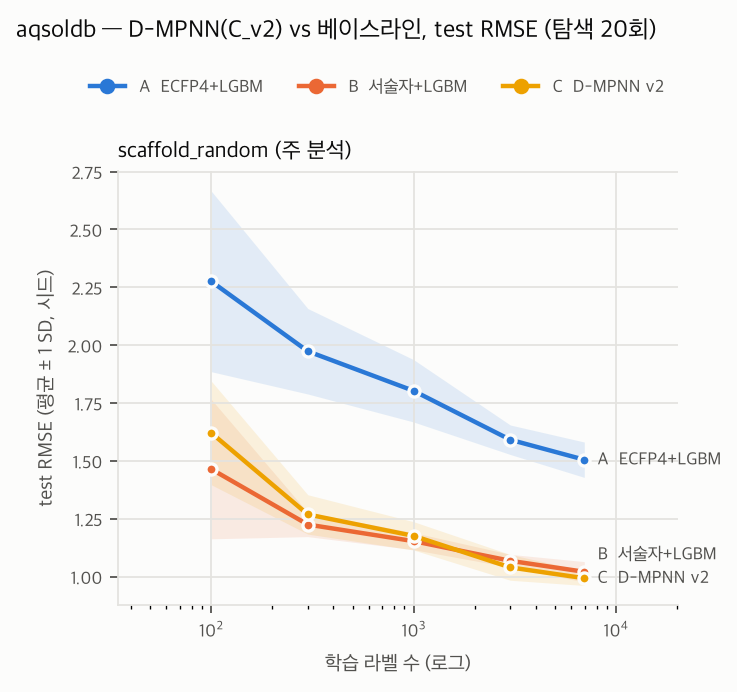

# GNN(C_v2) 결과 — aqsoldb

- 결과 파일: `reports/results/aqsoldb_gnn_v2_full.csv` + `reports/results/aqsoldb_baselines_full.csv` · 분할 **scaffold_random** · 주 지표 **RMSE** (작을수록 좋음) · 탐색 20회 체크포인트
- 정렬 확인: C 행 900개 모두 같은 (시드, 예산, 체크포인트)의 B 행과 n_train·n_valid·n_test 일치
- C 실행 조건: CPU 결정론 모드, 프로세스 6개 × 1스레드 (결정 G3·G5). 베이스라인은 LightGBM 8스레드

## 1. 예산별 성능 (평균 ± SD, 시드 수)

### scaffold_random (주 분석)

| 라벨 수 | A  ECFP4+LGBM | B  서술자+LGBM | C  D-MPNN v2 |
|---:|---:|---:|---:|
| 100 | 2.275 ± 0.390 (10) | 1.464 ± 0.302 (10) | 1.621 ± 0.224 (10) |
| 300 | 1.973 ± 0.185 (10) | 1.225 ± 0.052 (10) | 1.268 ± 0.085 (10) |
| 1000 | 1.802 ± 0.135 (10) | 1.153 ± 0.037 (10) | 1.176 ± 0.061 (10) |
| 3000 | 1.591 ± 0.064 (10) | 1.068 ± 0.028 (10) | 1.039 ± 0.056 (10) |
| full | 1.505 ± 0.076 (10) | 1.020 ± 0.044 (10) | 0.993 ± 0.031 (10) |

## 2. 시드 쌍 Wilcoxon (비교별로 예산 간 Holm 보정)

차이 = 앞 모델 − 뒤 모델의 RMSE. 음수면 앞 모델이 좋다.

| 비교 | 라벨 수 | 중앙값 차이 | 쌍 | p | p (Holm) |
|---|---:|---:|---:|---:|---:|
| C_dmpnn_v2 − B_desc_lgbm | 100 | 0.183 | 10 | 0.0195 | 0.0977 |
| C_dmpnn_v2 − B_desc_lgbm | 300 | 0.050 | 10 | 0.1309 | 0.3926 |
| C_dmpnn_v2 − B_desc_lgbm | 1000 | 0.024 | 10 | 0.1934 | 0.3926 |
| C_dmpnn_v2 − B_desc_lgbm | 3000 | -0.019 | 10 | 0.1309 | 0.3926 |
| C_dmpnn_v2 − B_desc_lgbm | full | -0.021 | 10 | 0.0195 | 0.0977 |
| C_dmpnn_v2 − A_ecfp_lgbm | 100 | -0.692 | 10 | 0.0020 | 0.0098 |
| C_dmpnn_v2 − A_ecfp_lgbm | 300 | -0.621 | 10 | 0.0020 | 0.0098 |
| C_dmpnn_v2 − A_ecfp_lgbm | 1000 | -0.611 | 10 | 0.0020 | 0.0098 |
| C_dmpnn_v2 − A_ecfp_lgbm | 3000 | -0.527 | 10 | 0.0020 | 0.0098 |
| C_dmpnn_v2 − A_ecfp_lgbm | full | -0.511 | 10 | 0.0020 | 0.0098 |

## 3. 시드별 C − B

양수 = C의 RMSE가 나쁘다. 마지막 줄은 B가 이긴 시드 수.

| 시드 | 100 | 300 | 1000 | 3000 | full |
|---:|---:|---:|---:|---:|---:|
| 0 | 0.252 | 0.132 | -0.036 | -0.047 | -0.072 |
| 1 | 0.273 | 0.103 | 0.094 | 0.014 | -0.049 |
| 2 | 0.137 | 0.055 | 0.026 | -0.012 | -0.067 |
| 3 | 0.357 | 0.134 | 0.020 | -0.026 | -0.052 |
| 4 | 0.327 | 0.001 | 0.070 | 0.033 | -0.004 |
| 5 | 0.072 | 0.045 | -0.010 | -0.060 | 0.010 |
| 6 | -0.172 | -0.059 | 0.073 | -0.158 | 0.002 |
| 7 | 0.071 | -0.007 | 0.025 | 0.005 | -0.004 |
| 8 | 0.229 | 0.086 | -0.057 | -0.007 | -0.029 |
| 9 | 0.019 | -0.051 | 0.024 | -0.026 | -0.014 |
| B 승 | 9/10 | 7/10 | 7/10 | 3/10 | 2/10 |

## 4. C의 탐색 횟수 체크포인트 효과

평균은 시드 하나의 실패에 끌려간다(아래 5회 full 참고). 중앙값을 함께 적는다.

| 라벨 수 | 5회 평균 | 10회 평균 | 20회 평균 | 5회 중앙값 | 10회 중앙값 | 20회 중앙값 |
|---:|---:|---:|---:|---:|---:|---:|
| 100 | 1.722 | 1.667 | 1.621 | 1.630 | 1.591 | 1.612 |
| 300 | 1.352 | 1.269 | 1.268 | 1.348 | 1.272 | 1.264 |
| 1000 | 1.188 | 1.171 | 1.176 | 1.192 | 1.140 | 1.174 |
| 3000 | 1.067 | 1.056 | 1.039 | 1.082 | 1.068 | 1.051 |
| full | 0.998 | 0.994 | 0.993 | 1.000 | 1.001 | 1.000 |

valid와 test 차이가 가장 큰 C 행 (선택은 valid로만 했으므로 test 실패는 그대로 남긴다):

| 시드 | 라벨 수 | 탐색 | valid RMSE | test RMSE |
|---:|---:|---:|---:|---:|
| 6 | 100 | 5 | 1.581 | 2.505 |
| 6 | 100 | 10 | 1.581 | 2.505 |
| 6 | 100 | 20 | 1.448 | 2.127 |

## 5. 선택된 하이퍼파라미터의 경계 쏠림 (탐색 20회)

탐색 범위 양 끝 5% 안에 든 비율 (하한 / 상한). 한쪽에 몰리면 범위를 넓혀야 했다는 신호다.

| 라벨 수 | 시드 | d_h | depth | dropout | lr | ffn_hidden | ffn_layers |
|---:|---:|---:|---:|---:|---:|---:|---:|
| 100 | 10 | 0% / 0% | 20% / 10% | 10% / 0% | 10% / 20% | 0% / 0% | 40% / 10% |
| 300 | 10 | 0% / 10% | 30% / 30% | 0% / 0% | 10% / 10% | 0% / 10% | 0% / 50% |
| 1000 | 10 | 0% / 0% | 30% / 10% | 0% / 10% | 10% / 10% | 0% / 20% | 10% / 70% |
| 3000 | 10 | 0% / 0% | 30% / 10% | 0% / 0% | 0% / 0% | 0% / 10% | 10% / 20% |
| full | 10 | 20% / 10% | 20% / 20% | 0% / 10% | 10% / 10% | 0% / 0% | 30% / 50% |
| 무작위 기대치 | | 5% / 5% | 20% / 20% | 5% / 5% | 5% / 5% | 5% / 5% | 33% / 33% |

## 6. 실행 시간 (C, 조합당: 탐색 20회 + 체크포인트 재학습)

1스레드 프로세스 6개가 동시에 돈 값이다. LightGBM(8스레드) 시간과 직접 비교하지 않는다.

잠자기·CPU 경합 구간에 걸쳐 시간 기록이 부풀려진 18개 조합은 이 표에서만 뺐다 (성능 분석에는 그대로 쓴다): `0:full`, `1:full`, `2:full`, `3:full`, `5:full`, `6:full`, `7:full`, `8:full`, `9:full`, `1:3000`, `2:3000`, `3:3000`, `4:3000`, `5:3000`, `6:3000`, `7:3000`, `8:3000`, `9:3000`

| 라벨 수 | 조합 수 | 평균 (분) | 최대 (분) |
|---:|---:|---:|---:|
| 100 | 10 | 6.3 | 9.5 |
| 300 | 10 | 10.2 | 14.2 |
| 1000 | 10 | 19.3 | 25.5 |
| 3000 | 1 | 20.2 | 20.2 |
| full | 1 | 47.8 | 47.8 |

## 7. 기존 C(mean readout 고정) · chemprop 기본값 대비

차이 = C_dmpnn_v2 − 비교 대상 RMSE. 음수면 C_dmpnn_v2가 낫다. 비교마다 예산 간 Holm.

| 라벨 수 | 기존 C | 새 C | 중앙값 차이 | p (Holm) | 좋아진 시드 | chemprop 기본값 | 새 C − 기본값 | p (Holm) |
|---:|---:|---:|---:|---:|---:|---:|---:|---:|
| 100 | 1.760 | 1.621 | -0.141 | 0.0488 | 7/10 | 1.943 | -0.292 | 0.0098 |
| 300 | 1.394 | 1.268 | -0.119 | 0.0098 | 10/10 | 1.514 | -0.253 | 0.0098 |
| 1000 | 1.255 | 1.176 | -0.094 | 0.0176 | 9/10 | 1.275 | -0.102 | 0.0098 |
| 3000 | 1.153 | 1.039 | -0.114 | 0.0098 | 10/10 | 1.097 | -0.051 | 0.0098 |
| full | 1.060 | 0.993 | -0.087 | 0.0176 | 9/10 | 0.997 | -0.001 | 0.9219 |

## 8. 선택된 readout (탐색 20회, valid로 선택)

| 라벨 수 | norm 선택 시드 |
|---:|---:|
| 100 | 8/10 |
| 300 | 10/10 |
| 1000 | 10/10 |
| 3000 | 10/10 |
| full | 10/10 |
