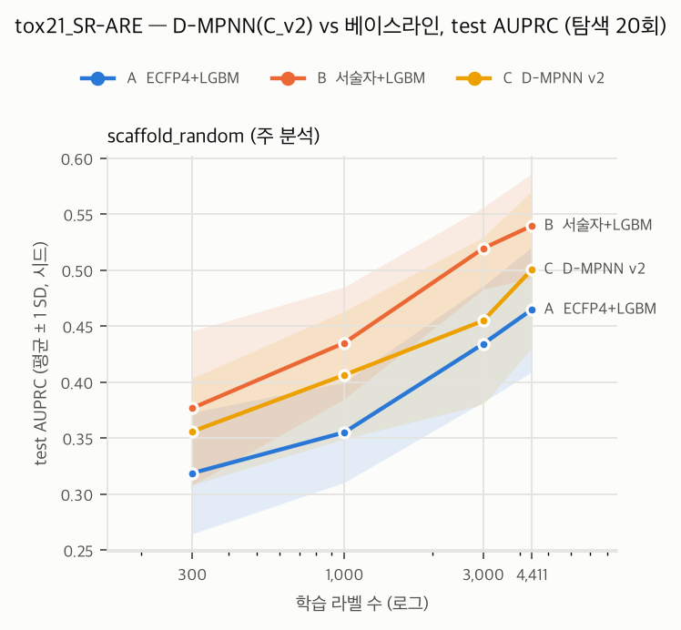

# GNN(C_v2) 결과 — tox21_SR-ARE

- 결과 파일: `reports/results/tox21_SR-ARE_gnn_v2_full.csv` + `reports/results/tox21_SR-ARE_baselines_full.csv` · 분할 **scaffold_random** · 주 지표 **AUPRC** (클수록 좋음) · 탐색 20회 체크포인트
- 정렬 확인: C 행 1200개 모두 같은 (시드, 예산, 체크포인트)의 B 행과 n_train·n_valid·n_test 일치
- C 실행 조건: CPU 결정론 모드, 프로세스 6개 × 1스레드 (결정 G3·G5). 베이스라인은 LightGBM 8스레드

## 1. 예산별 성능 (평균 ± SD, 시드 수)

### scaffold_random (주 분석)

| 라벨 수 | A  ECFP4+LGBM | B  서술자+LGBM | C  D-MPNN v2 |
|---:|---:|---:|---:|
| 300 | 0.319 ± 0.054 (10) | 0.377 ± 0.069 (10) | 0.356 ± 0.048 (10) |
| 1000 | 0.355 ± 0.045 (10) | 0.435 ± 0.050 (10) | 0.406 ± 0.057 (10) |
| 3000 | 0.434 ± 0.052 (10) | 0.519 ± 0.037 (10) | 0.455 ± 0.075 (10) |
| full | 0.465 ± 0.056 (10) | 0.540 ± 0.047 (10) | 0.501 ± 0.070 (10) |

## 2. 시드 쌍 Wilcoxon (비교별로 예산 간 Holm 보정)

차이 = 앞 모델 − 뒤 모델의 AUPRC. 양수면 앞 모델이 좋다.

| 비교 | 라벨 수 | 중앙값 차이 | 쌍 | p | p (Holm) |
|---|---:|---:|---:|---:|---:|
| C_dmpnn_v2 − B_desc_lgbm | 300 | -0.013 | 10 | 0.4316 | 0.4316 |
| C_dmpnn_v2 − B_desc_lgbm | 1000 | -0.038 | 10 | 0.1055 | 0.2109 |
| C_dmpnn_v2 − B_desc_lgbm | 3000 | -0.049 | 10 | 0.0039 | 0.0156 |
| C_dmpnn_v2 − B_desc_lgbm | full | -0.029 | 10 | 0.0645 | 0.1934 |
| C_dmpnn_v2 − A_ecfp_lgbm | 300 | 0.047 | 10 | 0.0273 | 0.0547 |
| C_dmpnn_v2 − A_ecfp_lgbm | 1000 | 0.028 | 10 | 0.0039 | 0.0156 |
| C_dmpnn_v2 − A_ecfp_lgbm | 3000 | 0.034 | 10 | 0.0840 | 0.0840 |
| C_dmpnn_v2 − A_ecfp_lgbm | full | 0.026 | 10 | 0.0137 | 0.0410 |

## 3. 시드별 C − B

양수 = C의 AUPRC가 좋다. 마지막 줄은 B가 이긴 시드 수.

| 시드 | 300 | 1000 | 3000 | full |
|---:|---:|---:|---:|---:|
| 0 | -0.031 | -0.036 | -0.051 | -0.027 |
| 1 | 0.009 | -0.094 | -0.084 | -0.102 |
| 2 | -0.146 | -0.040 | -0.207 | 0.023 |
| 3 | -0.029 | -0.014 | -0.048 | 0.071 |
| 4 | 0.015 | -0.076 | -0.026 | -0.023 |
| 5 | -0.036 | -0.049 | -0.038 | -0.073 |
| 6 | 0.005 | -0.062 | -0.062 | -0.100 |
| 7 | 0.085 | 0.083 | 0.008 | -0.031 |
| 8 | -0.084 | 0.004 | -0.017 | -0.018 |
| 9 | 0.002 | -0.003 | -0.120 | -0.110 |
| B 승 | 5/10 | 8/10 | 9/10 | 8/10 |

## 4. C의 탐색 횟수 체크포인트 효과

평균은 시드 하나의 실패에 끌려간다. 중앙값을 함께 적는다.

| 라벨 수 | 5회 평균 | 10회 평균 | 20회 평균 | 5회 중앙값 | 10회 중앙값 | 20회 중앙값 |
|---:|---:|---:|---:|---:|---:|---:|
| 300 | 0.344 | 0.359 | 0.356 | 0.343 | 0.351 | 0.351 |
| 1000 | 0.373 | 0.387 | 0.406 | 0.390 | 0.394 | 0.407 |
| 3000 | 0.436 | 0.451 | 0.455 | 0.469 | 0.478 | 0.480 |
| full | 0.478 | 0.506 | 0.501 | 0.488 | 0.503 | 0.518 |

valid와 test 차이가 가장 큰 C 행 (선택은 valid로만 했으므로 test 실패는 그대로 남긴다):

| 시드 | 라벨 수 | 탐색 | valid AUPRC | test AUPRC |
|---:|---:|---:|---:|---:|
| 2 | 3000 | 5 | 0.595 | 0.321 |
| 2 | 3000 | 10 | 0.595 | 0.321 |
| 2 | 3000 | 20 | 0.595 | 0.321 |

## 5. 선택된 하이퍼파라미터의 경계 쏠림 (탐색 20회)

탐색 범위 양 끝 5% 안에 든 비율 (하한 / 상한). 한쪽에 몰리면 범위를 넓혀야 했다는 신호다.

| 라벨 수 | 시드 | d_h | depth | dropout | lr | ffn_hidden | ffn_layers |
|---:|---:|---:|---:|---:|---:|---:|---:|
| 300 | 10 | 0% / 0% | 20% / 20% | 20% / 10% | 0% / 20% | 0% / 20% | 20% / 50% |
| 1000 | 10 | 0% / 0% | 20% / 30% | 30% / 0% | 0% / 10% | 20% / 10% | 30% / 20% |
| 3000 | 10 | 0% / 0% | 20% / 10% | 10% / 10% | 0% / 0% | 0% / 20% | 30% / 40% |
| full | 10 | 10% / 0% | 0% / 20% | 0% / 0% | 0% / 0% | 10% / 0% | 30% / 20% |
| 무작위 기대치 | | 5% / 5% | 20% / 20% | 5% / 5% | 5% / 5% | 5% / 5% | 33% / 33% |

## 6. 실행 시간 (C, 조합당: 탐색 20회 + 체크포인트 재학습)

1스레드 프로세스 6개가 동시에 돈 값이다. LightGBM(8스레드) 시간과 직접 비교하지 않는다.

| 라벨 수 | 평균 (분) | 최대 (분) | 합계 (시간) |
|---:|---:|---:|---:|
| 300 | 5.3 | 8.6 | 0.9 |
| 1000 | 13.2 | 20.7 | 2.2 |
| 3000 | 40.4 | 50.0 | 6.7 |
| full | 57.0 | 70.7 | 9.5 |

## 7. 선택된 readout (탐색 20회, valid로 선택)

| 라벨 수 | norm 선택 시드 |
|---:|---:|
| 300 | 9/10 |
| 1000 | 7/10 |
| 3000 | 8/10 |
| full | 9/10 |

## 8. 분류 보조: AUROC와 양성률

AUPRC의 무작위 기준선은 test 양성률이다. AUROC는 불균형에서 낙관적이므로 보조로만 읽는다.

| 라벨 수 | test 양성률 | AUROC A  ECFP4+LGBM | AUROC B  서술자+LGBM | AUROC C  D-MPNN v2 | C − B 중앙값 | p (Holm) |
|---:|---:|---:|---:|---:|---:|---:|
| 300 | 20.4% | 0.636 | 0.704 | 0.664 | -0.042 | 0.0645 |
| 1000 | 20.4% | 0.669 | 0.747 | 0.719 | -0.035 | 0.0391 |
| 3000 | 20.4% | 0.731 | 0.794 | 0.750 | -0.039 | 0.0078 |
| full | 20.4% | 0.751 | 0.806 | 0.780 | -0.030 | 0.0293 |
